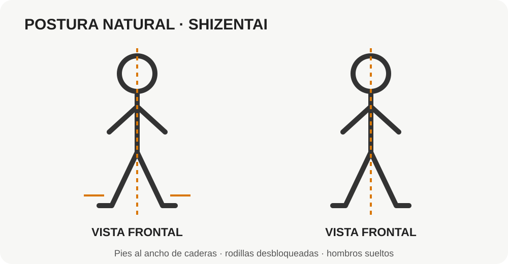
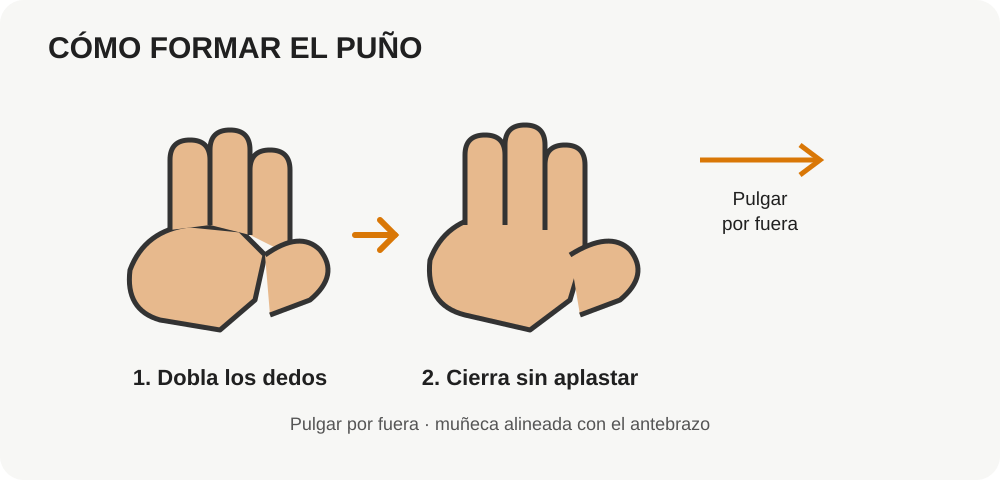
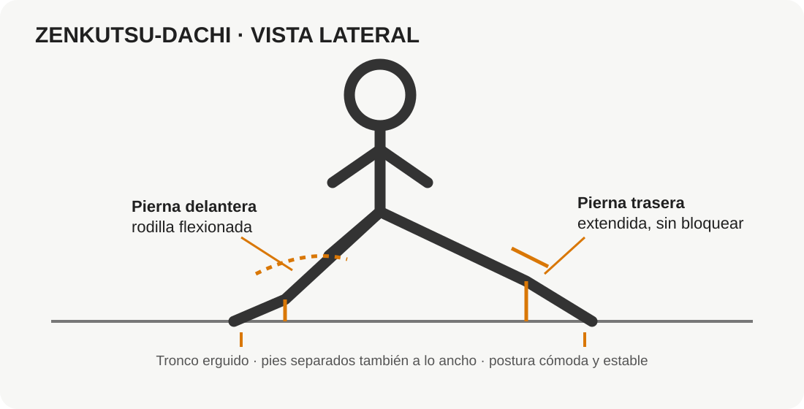
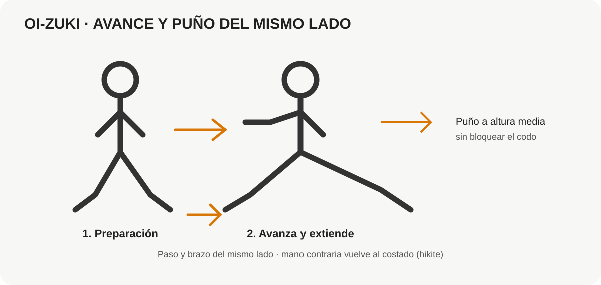

# Capítulo 1 — Construir la base

**Nivel orientativo:** principiante · referencia 10.º Kyū  
**Contenido:** postura natural, puños relajados, zenkutsu-dachi introductorio y primer oi-zuki al aire.

> En esta primera sesión no buscamos pegar fuerte ni moverte rápido. Buscamos que puedas colocarte, mantener el equilibrio y coordinar el cuerpo sin tensarte de más.

## 1. Preparación

**Necesitas:** ropa cómoda, suelo que no resbale y espacio libre alrededor. Practica descalzo solo si el suelo es seguro y no te causa molestias.

Antes de empezar, dedica 3–5 minutos a caminar suavemente por el espacio, mover hombros, codos, muñecas, cadera, rodillas y tobillos. No fuerces estiramientos.

## 2. Postura natural — Shizentai

La postura natural es tu punto de partida. No es una pose rígida.

1. Separa los pies aproximadamente al ancho de tus caderas.
2. Reparte el peso entre ambos pies.
3. Deja las rodillas desbloqueadas; no las encajes hacia atrás.
4. Mantén la pelvis neutra y el abdomen sin apretarlo al máximo.
5. Crece desde la coronilla: espalda larga, hombros sueltos y mirada al frente.
6. Respira con normalidad.

**Comprueba:** puedes levantar ligeramente un pie y volver a apoyarlo sin que el tronco se balancee demasiado. Repite con el otro.

**Error frecuente:** sacar el pecho exageradamente, arquear la zona lumbar o mantener todo el cuerpo rígido.

## 3. Cerrar la mano sin tensarla de más

Para practicar el puño:

1. Dobla los dedos desde las falanges, sin aplastarlos contra la palma.
2. Coloca el pulgar por fuera, apoyado sobre los dedos índice y medio. Nunca lo escondas dentro del puño.
3. Mantén la muñeca alineada con el antebrazo.
4. Aprieta solo lo necesario para conservar la forma; no mantengas el puño contraído todo el día.

**Importante:** practica al aire. No golpees paredes, árboles, puertas ni superficies duras. Un puño mal alineado puede lesionarte la muñeca o los nudillos.

## 4. Primera posición — Zenkutsu-dachi (introducción)

Es una posición adelantada muy característica del Shotokan. En esta primera aproximación:

1. Da un paso hacia delante, sin cruzar los pies.
2. Separa los pies también lateralmente: no camines sobre una sola línea.
3. Flexiona la rodilla delantera de forma cómoda, siguiendo la dirección de los dedos del pie.
4. Deja la pierna trasera extendida sin bloquear la rodilla.
5. Mantén el talón trasero apoyado si tu movilidad lo permite; el pie puede abrirse ligeramente hacia fuera.
6. Orienta la pelvis y el tronco al frente, sin inclinarte sobre la rodilla.
7. Reparte el peso principalmente hacia la pierna delantera, pero conserva estabilidad.

No fuerces una zancada enorme ni intentes bajar mucho. La longitud y profundidad exactas varían según proporciones corporales, movilidad y escuela. Primero domina una versión cómoda y estable.

**Comprueba:** mantén la posición 10 segundos respirando. No debe doler la rodilla, la cadera ni la zona lumbar. Si pierdes el equilibrio, acorta la postura.

**Errores frecuentes:**
- Pies colocados en una misma línea, como si caminaras por una cuerda.
- Rodilla delantera colapsando hacia dentro.
- Talón trasero levantado por forzar demasiado la longitud.
- Tronco inclinado hacia delante.
- Zancada tan larga que no puedes moverte con facilidad.

## 5. Primer golpe al aire — Oi-zuki chūdan (solo coordinación)

El oi-zuki es un puñetazo que acompaña el avance: adelanta la pierna y el brazo del mismo lado. En esta lección lo haremos despacio y sin impacto.

1. Empieza erguido, con los pies separados y las manos relajadas cerca del torso.
2. Da un paso natural hacia delante con una pierna.
3. Mientras el pie avanza, lleva el puño del mismo lado hacia delante, a la altura media del torso imaginario.
4. La otra mano vuelve hacia el costado, cerca de la cintura (hikite), sin tirar violentamente del hombro.
5. Apoya el pie y termina estable. El puño queda alineado con el antebrazo; hombro bajo y cuello relajado.
6. Detén el movimiento sin bloquear el codo. Vuelve caminando a la posición inicial y repite con el otro lado.

**No intentes generar potencia todavía.** El objetivo es coordinar paso, cadera y brazo sin perder el equilibrio. No gires la muñeca de forma brusca ni hiperextiendas el codo.

## 6. Práctica de hoy

Haz la sesión sin prisa:

| Ejercicio | Cantidad |
|---|---:|
| Postura natural y respiración | 3 × 20 segundos |
| Formar y relajar el puño | 10 veces por mano |
| Zenkutsu-dachi cómodo | 3 × 10 segundos por lado |
| Entrar y salir de la posición | 5 veces por lado |
| Oi-zuki lento al aire | 5 repeticiones por lado |
| Secuencia completa lenta | 3 veces por lado |

Descansa cuando lo necesites. Si estás empezando desde una vida sedentaria, puedes hacer una sola ronda los primeros días.

## 7. Lista de comprobación

Antes de dar por terminado el capítulo, revisa:

- [ ] Puedo adoptar una postura natural sin poner rígido el cuerpo.
- [ ] Puedo cerrar el puño con el pulgar por fuera y la muñeca alineada.
- [ ] Puedo mantener zenkutsu-dachi sin dolor y sin perder el equilibrio.
- [ ] Mis pies no quedan sobre una sola línea.
- [ ] Puedo avanzar y coordinar el puño del mismo lado sin inclinar el tronco.
- [ ] Puedo detener el golpe sin bloquear el codo ni encoger el hombro.

No hace falta que todo salga perfecto en una sesión. Repite en días distintos y prioriza el control.

## 8. Cuándo pasar al capítulo 2

Pasa cuando puedas hacer las posiciones y el oi-zuki lentamente, con equilibrio y sin dolor. En el siguiente capítulo trabajaremos cómo entrar, salir y desplazarte manteniendo la postura; después añadiremos más técnicas de brazo.

**Fin del capítulo 1.** La velocidad vendrá después de la coordinación.
